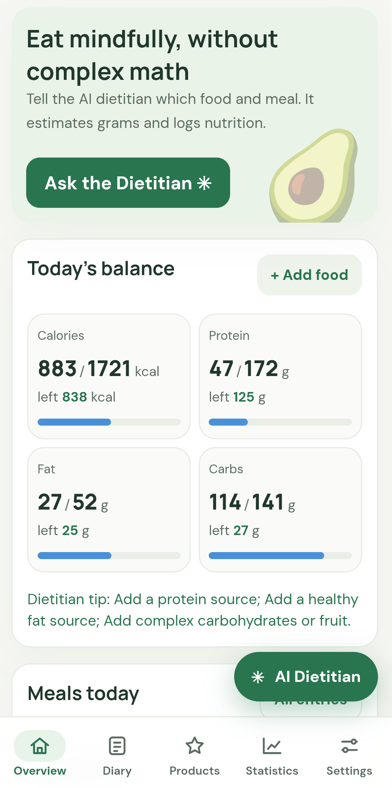
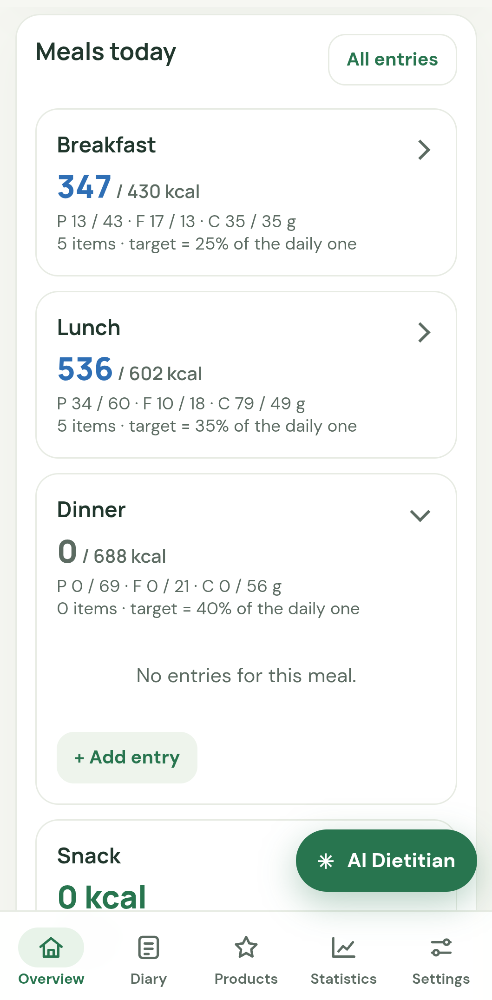
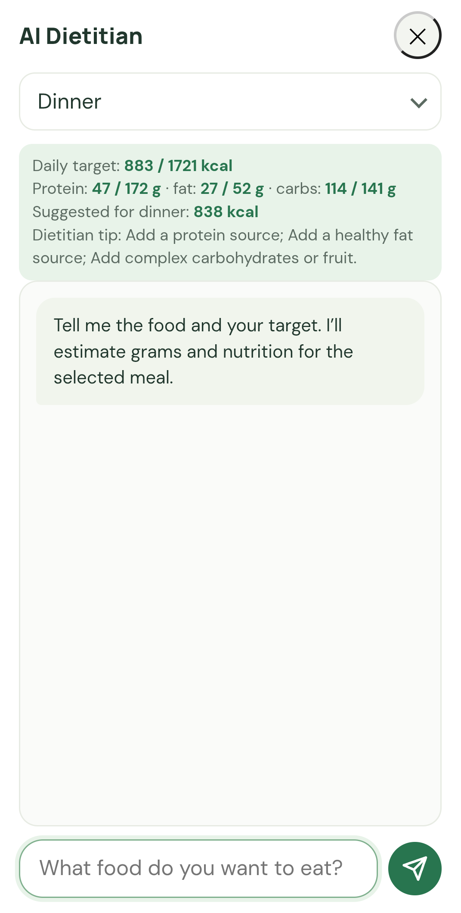
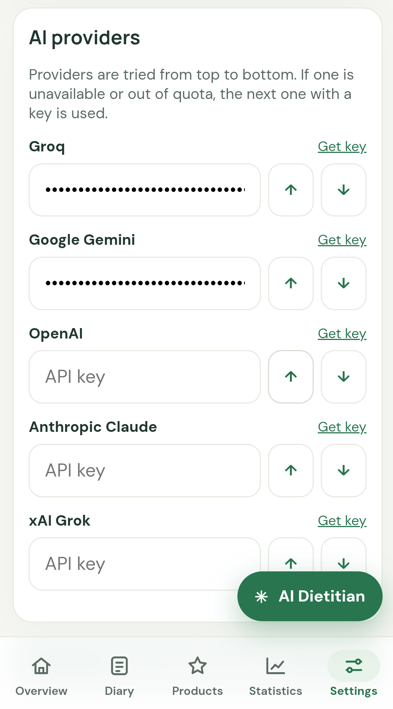

# Smart Diet AI

**A simple food diary with an AI assistant.** Describe what you ate in your own words, and the app estimates the weight, calories, protein, fat and carbs. See how much of your daily goal is left, follow your weight over time, and keep all your meals in one place.

🌐 [Українська версія](README.uk.md) · 🔗 [Open the app](https://smart-diet-ai-psi.vercel.app/)

  
  
  
  

## What you can do

**Track your day**
- Add food by name, pick it from your saved products, or enter the amount yourself.
- See calories, protein, fat and carbs for the day, and how much is left or how much you went over.
- Meals are split into breakfast, lunch, dinner and snacks. Tap a meal to open or close it.

**Get help from AI**
- **AI Dietitian:** type what you want to eat. The app estimates the grams and nutrition and suggests how much fits your calories for that meal. Add the result to your diary with one tap.
- **Choose a character:** in **Settings → AI personality**, pick *Polite and cultured* or *Playful and cheeky*. The choice applies to the AI Dietitian, meal analysis and short messages in the app.
- **Analyze buttons:** next to each meal and next to today's meals on the Overview and Diary screens, get a short review of that meal or of the whole day, with 2–3 tips.
- **Ask the Dietitian:** ask any general nutrition question. These questions do not include your diary or your profile.

**Save products you eat often**
- Keep foods in "My products" with a standard portion, and add them to your diary in seconds.

**Follow your weight**
- Log your weight by date and see the chart and the trend.
- A BMI gauge shows where you are and what a healthy weight range looks like for your height.
- Enter your details and get a daily calorie and protein target. You can choose a gentle pace of 0.25, 0.5 or 0.75 kg per week.

**Calendar and backup**
- Pick any date in the calendar. Days with saved entries are marked with a dot.
- Export your data to a file and import it on another device.

**Other**
- English and Ukrainian interface.
- Install it on your phone or computer like an app (see below).

## Getting started

Smart Diet AI works in two ways:

- **In your browser:** open the [app link](https://smart-diet-ai-psi.vercel.app/) on any phone or computer.
- **As a shortcut:** add it to your home screen or desktop. It then opens in its own window, like a regular app.

**How to add a shortcut**
- **Android (Chrome):** open the menu (⋮) and tap *Install app* or *Add to Home screen*.
- **iPhone (Safari):** tap *Share*, then *Add to Home Screen*.
- **Computer (Chrome or Edge):** click the install icon at the right end of the address bar, or open the menu and choose *Install Smart Diet AI*.

Then:
1. Enter your details in **Settings** to get a daily calorie target.
2. Start adding meals on **Overview** or **Diary**.

**AI features need your own key.** Add a key from at least one provider in **Settings → AI providers**: Google Gemini, OpenAI, Anthropic Claude, Groq or xAI Grok. Each provider has its own page where you can create a key. Your text goes only to the provider you chose.

## Good to know

- **Internet:** you need internet to open the app for the first time and to use the AI features (AI Dietitian, meal analysis, Ask the Dietitian). After your first visit, the app screens open without internet and your diary stays available.
- **iPhone:** the home-screen app keeps its own data, separate from Safari. Export a backup if you switch between them.
- **Your data is saved in the browser on your device.** If you clear the site data in your browser, your entries are deleted. Export a backup from **Settings** from time to time.
- **The numbers are estimates, not medical advice.** The app is for adults (18+). Talk to a doctor or a dietitian first if you are pregnant, under 18, living with a medical condition, or recovering from an eating disorder.

## License

MIT. See [LICENSE](LICENSE).
