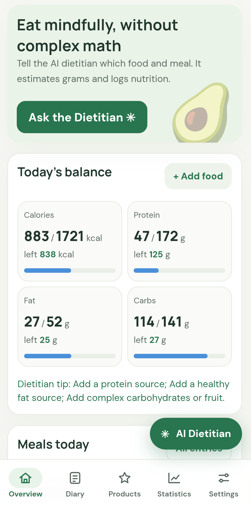
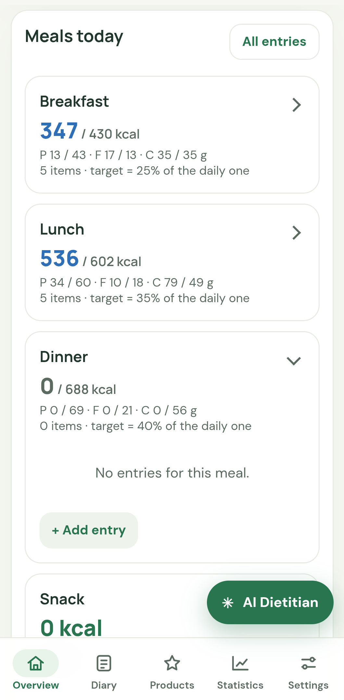
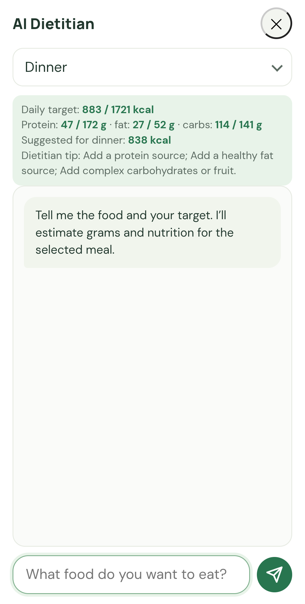
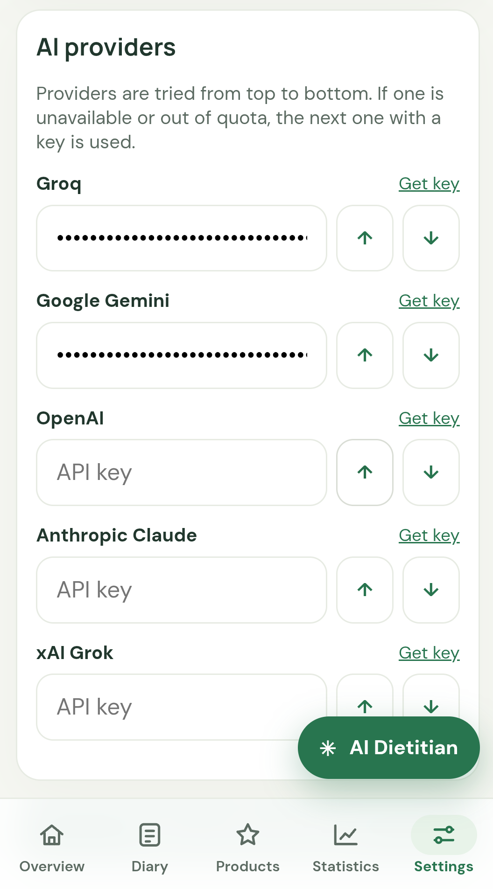

# Smart Diet AI

**Простий харчовий щоденник зі штучним інтелектом.** Опиши, що ти з'їв, своїми словами, а застосунок оцінить вагу, калорії, білки, жири та вуглеводи. Бачиш, скільки лишилось до денної норми, відстежуєш вагу в динаміці й тримаєш усі прийоми їжі в одному місці.

🌐 [English version](README.md) · 🔗 [Відкрити застосунок](https://smart-diet-ai-psi.vercel.app/)

  
  
  
  

## Що можна зробити

**Веди день**
- Додавай їжу за назвою, вибирай збережений продукт або вказуй кількість самостійно.
- Бачиш калорії, білки, жири й вуглеводи за день і те, скільки лишилось або скільки перевищено.
- Прийоми їжі поділено на сніданок, обід, вечерю та перекус. Натисни на прийом, щоб відкрити або згорнути його.

**Отримуй допомогу від ШІ**
- **ШІ-дієтолог:** напиши, що хочеш з'їсти. Застосунок оцінить грами та поживну цінність і підкаже, скільки вміщається в калорії для цього прийому. Результат додається в щоденник одним натисканням.
- **Обери характер:** у **Налаштуваннях → Характер ШІ** вибери «Ввічливий і культурний» або «З приколами і легкою пошлістю». Вибір діє в ШІ-дієтологу, аналізах прийомів і коротких написах у застосунку.
- **Вибір моделі ШІ:** у **Налаштуваннях → Провайдери ШІ** обери *Авто*, модель зі списку або введи свій ID моделі. Кнопка *Перевірити* показує, чи відповідає модель. *Авто* використовує лише моделі Gemini і Groq, тому потребує ключа Gemini або Groq. Моделі OpenAI, Anthropic і xAI працюють лише тоді, коли ти їх обираєш, а платні моделі можуть коштувати грошей. Безкоштовні тарифи мають ліміти, а на безкоштовному тарифі Gemini Google може використовувати дані для покращення своїх продуктів.
- **Сповіщення:** короткі повідомлення з’являються праворуч угорі на 10 секунд і закриваються хрестиком. Ті, що зникли самі, зберігаються в списку дзвіночка з лічильником як непрочитані; закриті хрестиком позначаються прочитаними. Можна прочитати всі або видалити кожне окремо. Список зберігається лише на цьому пристрої.
- **Очищення сховища:** якщо пам’ять браузера заповнена, застосунок пропонує видалити записи щоденника старші за 12 місяців, які вже збережені в хмарі. Профіль, вага, цілі та продукти лишаються.
- **Кнопки аналізу:** біля кожного прийому їжі та біля «Прийоми їжі сьогодні» на екранах «Огляд» і «Щоденник» можна отримати короткий розбір прийому або всього дня з 2–3 порадами.
- **Запитати дієтолога:** став будь-яке загальне питання про харчування. У цих питаннях не передаються ні твій щоденник, ні твій профіль.

**Зберігай продукти, які їси часто**
- Тримай їжу в розділі «Мої продукти» зі стандартною порцією і додавай до щоденника за кілька секунд.
- У формі продукту можна зчитати скопійований текст із буфера обміну: застосунок показує джерело та знайдені калорії, білки, жири й вуглеводи, які можна виправити перед перенесенням у форму. Попередні значення видно в дужках поруч із назвами полів до збереження. Розбір виконується локально, дані не зберігаються без підтвердження. Кнопка «Знайти калорійність» і далі відкриває пошук Google у новій вкладці.
- Познач продукт як перевірений у його налаштуваннях; біля нього в списку «Мої продукти» з’явиться галочка.

**Стеж за вагою**
- Записуй вагу з датою і дивись графік та тренд. Відкривай графік динаміки прямо з картки останньої ваги на екрані огляду, а всі вимірювання переглядай у прокручуваному вікні історії.
- Індикатор ІМТ показує, де ти зараз і який діапазон ваги вважається здоровим для твого зросту.
- Вкажи свої дані та отримай денну норму калорій і білків. Можна обрати повільний темп: 0,25, 0,5 або 0,75 кг на тиждень.

**Календар і резервна копія**
- Обирай будь-яку дату в календарі. Календар щоденника підсвічує дні з прийомами їжі, а календар запису ваги — дні зі збереженими зважуваннями.
- Чернетки прийомів зберігаються лише в цьому браузері й прив’язані до акаунта, увійденого на цьому пристрої. Вони не синхронізуються з хмарою і не переходять на інший пристрій чи в інший акаунт.
- Налаштування й цілі зберігаються в резервній копії на цьому пристрої, навіть якщо ще немає записів їжі, ваги чи продуктів. Зберігаються три останні архіви чужих акаунтів; щоб додати новий архів, найстаріший видаляється лише після твого підтвердження.
- **Журнал дій:** застосунок веде журнал останніх дій на цьому пристрої: записи щоденника, вагу, цілі, профіль, зміни продуктів, спільні продукти та резервні копії. Відкрити його можна в Налаштуваннях → Дані та приватність або в розділі «Мої продукти».
- **Автозбереження в налаштуваннях:** якщо ти переходиш із блоку налаштувань з незбереженими змінами до іншого блоку, застосунок зберігає попередній блок.
- **Зміни цілей:** нові цілі калорій і макронутрієнтів діють з дня, коли ти їх зберіг. Попередні дні зберігають цілі, які діяли тоді.
- Експортуй дані у файл і імпортуй їх на іншому пристрої.
- Поділися застосунком із друзями в **Налаштуваннях**.

**Інше**
- Інтерфейс англійською та українською мовами.
- Можна встановити на телефон або комп'ютер як застосунок (див. нижче).

## З чого почати

Smart Diet AI працює двома способами:

- **У браузері:** відкрий [посилання на застосунок](https://smart-diet-ai-psi.vercel.app/) на будь-якому телефоні чи комп'ютері.
- **Як ярлик:** додай застосунок на головний екран телефону або на робочий стіл комп'ютера. Тоді він відкриватиметься у власному вікні, як звичайна програма.

**Як додати ярлик**
- **Android (Chrome):** відкрий меню (⋮) і натисни *Установити застосунок* або *Додати на головний екран*.
- **iPhone (Safari):** натисни *Поділитися*, а потім *На екран «Додому»*.
- **Комп'ютер (Chrome або Edge):** натисни значок встановлення праворуч у рядку адреси або відкрий меню і обери *Установити Smart Diet AI*.

Далі:
1. Вкажи свої дані в **Налаштуваннях**, щоб отримати денну норму калорій.
2. Почни додавати прийоми їжі на екранах **Огляд** або **Щоденник**.

**Для ШІ-функцій потрібен твій ключ.** Додай ключ хоча б одного провайдера в **Налаштування → Провайдери ШІ**: Google Gemini, OpenAI, Anthropic Claude, Groq або xAI Grok. У кожного провайдера є сторінка, де можна створити ключ. Твій текст надсилається лише тому провайдеру, якого ти обрав.

## Варто знати

- **Інтернет:** щоб вперше відкрити застосунок і користуватися ШІ-функціями (ШІ-дієтолог, аналіз прийомів їжі, «Запитати дієтолога»), потрібен інтернет. Після першого відкриття екрани застосунку відкриваються без інтернету, а щоденник залишається доступним.
- **iPhone:** застосунок на головному екрані має власні дані, окремі від Safari. Якщо переходиш між ними, зроби резервну копію через експорт.
- **Дані зберігаються в браузері на твоєму пристрої.** Якщо очистити дані сайту в браузері, записи буде видалено. Час від часу роби резервну копію в **Налаштуваннях**.
- **Цифри є оцінкою, а не медичною порадою.** Застосунок призначено для дорослих (18+). Спершу проконсультуйся з лікарем або дієтологом, якщо ти вагітна, молодша за 18 років, маєш хронічне захворювання чи відновлюєшся після розладу харчової поведінки.

## Ліцензія

MIT. Див. [LICENSE](LICENSE).
